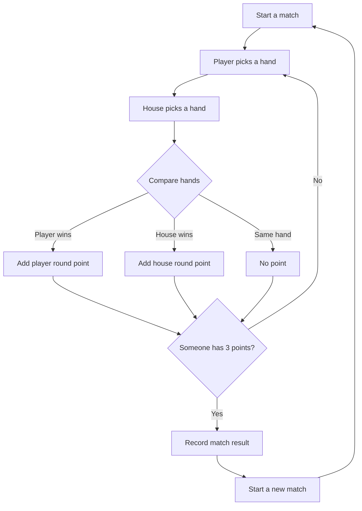

# Pulse Hands

A quick, head-to-head rock-paper-scissors arcade match. Read the rhythm, pick a hand, and be the first to take three rounds.

**Play:** [oscarmmi.github.io/rps](https://oscarmmi.github.io/rps/)

## How to play

- Play against the house in a best-of-five match. First to three round wins takes the match.
- Choose **Rock**, **Paper**, or **Scissors** by clicking or tapping a hand.
- Use keyboard shortcuts **1** for Rock, **2** for Paper, and **3** for Scissors. Press **N** to reset the match.
- Rock beats Scissors, Scissors beats Paper, and Paper beats Rock. Matching hands draw; a draw does not score a point.
- Your match wins are saved in this browser. Round scores and the round log reset when you start another match.

## Run locally

Requires Node.js 20 or newer.

```sh
npm install
npm run dev
```

Run the game-logic tests and production build:

```sh
npm test
npm run build
```

## Game loop



## Built with

Vue 3, TypeScript, and Vite. The game runs entirely in the browser with no backend.
